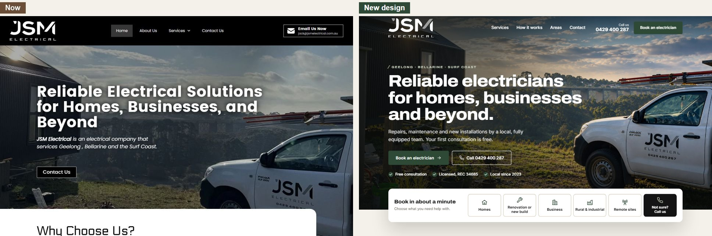
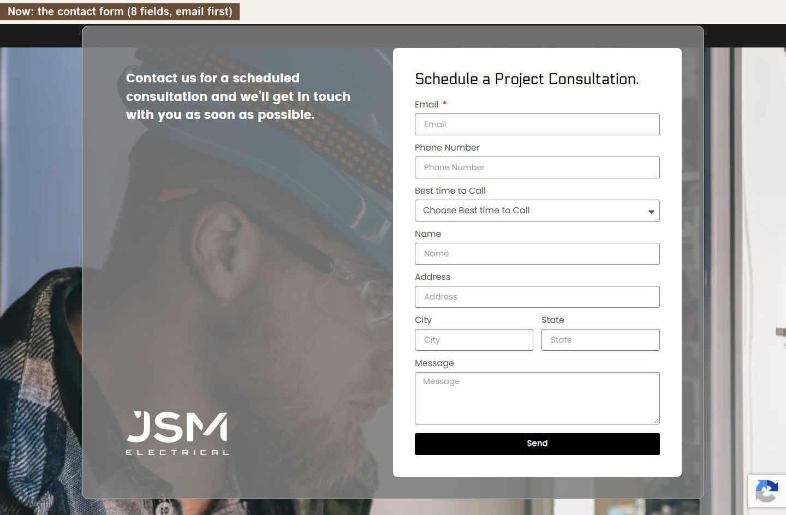
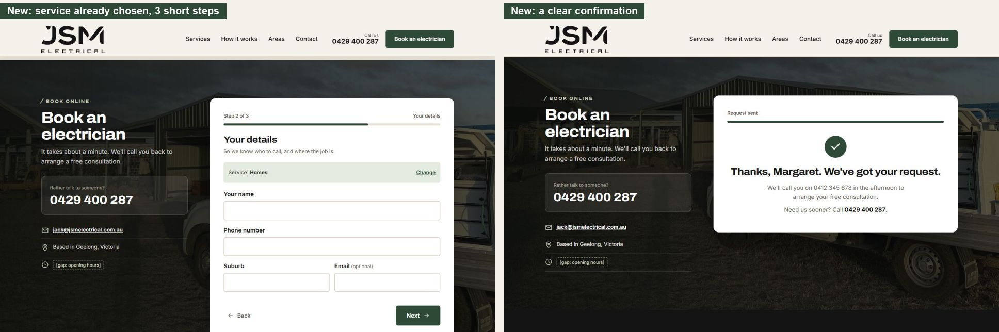
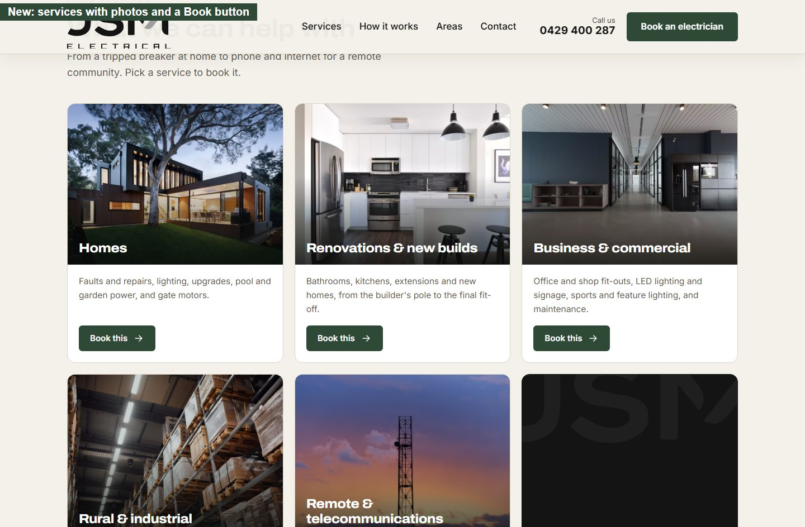
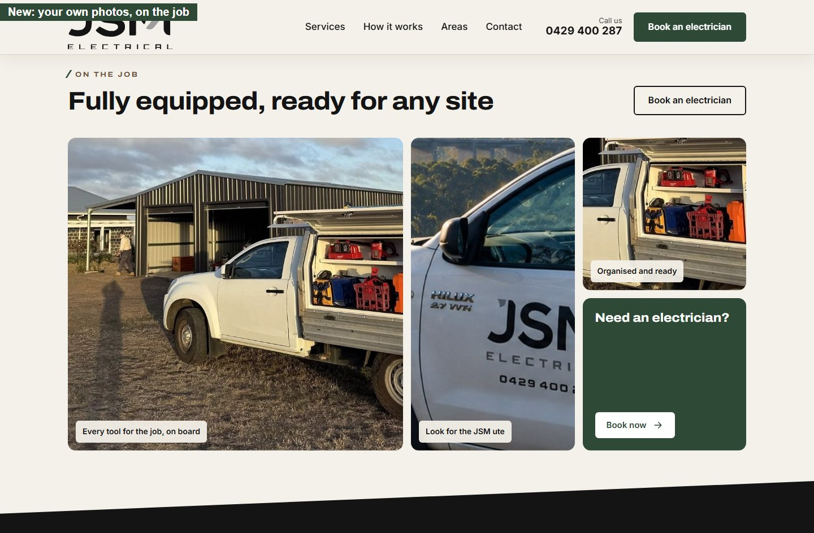
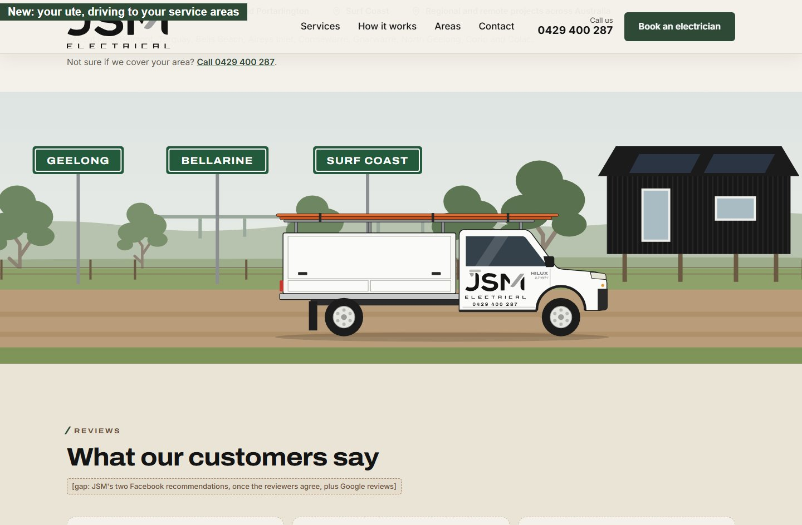
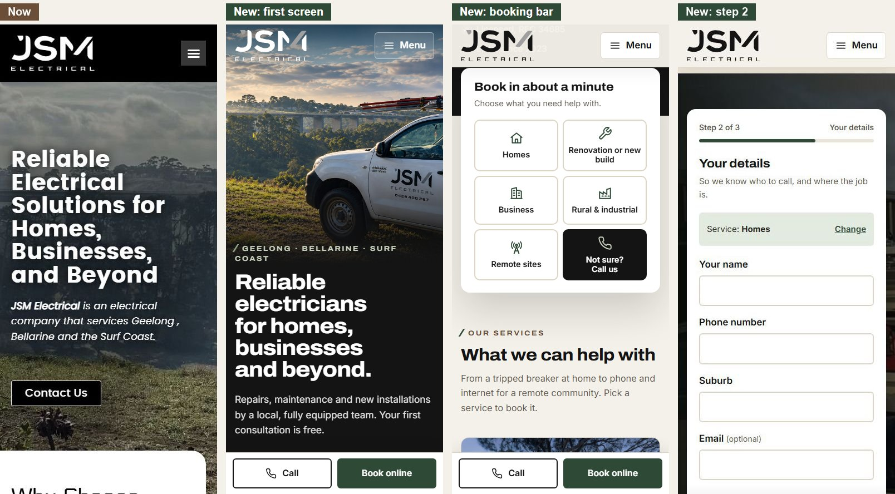

# A website that books jobs for JSM Electrical

**Website revamp proposal** · Prepared for JSM Electrical · 21 October 2026 · Prepared by the Global Webforce team

---

## In short

We built your current website, and it gives JSM a professional face online: your ute is front and centre, and the black-and-white brand is strong. Going back through it the way a customer would, we found it doesn't make booking easy enough.

A customer who wants an electrician has to:
- find a contact page;
- fill in eight fields, starting with their email address;
- wait, without being told what happens next.

On a phone, there's no phone number at the top of the page, and the photo of your ute doesn't even show. And the site shows only part of your work: the builders, farms and remote communities that fill your Instagram have no place on it.

**We propose a revamp that keeps everything you like about the current site and makes booking take about a minute.** Your own photos and your ute stay the hero. Colours from the paddocks and job sites in your photos give it a warm, local feel. Booking starts on the very first screen.

This document shows what we found, what the new site looks like, what we need from you to build it, and a few questions to talk through. **We're asking you to approve the full build.**

---

## What's working, and stays

We're keeping all of this:

- **Your ute as the hero image.** It's distinctive and it's yours.
- **The range of work you cover,** from homes and shops to industrial sites and underground cabling.
- **A strong black-and-white brand** and your logo.
- **Your local focus:** Geelong, the Bellarine Peninsula and the Surf Coast.

---

## What's holding the site back

We went back through your site page by page, on a computer and on a phone, the way a customer would. Most of what we found is about booking: the site was built to show who you are, and it now needs to turn visits into jobs.

### Booking is harder than it should be

| What we found | What your customer experiences |
|---|---|
| No "book" button anywhere. The only path is a "Contact Us" page | "Where do I actually book?" |
| The contact form has 8 fields, and email is the first and only required one | A long form that wants an email address before anything else. Some people give up here |
| The form is headed "Schedule a Project Consultation" | Sounds like a big, expensive commitment for a tripped breaker |
| After sending, nothing explains what happens next | "Did it work? When will they call?" |

### The phone number is hard to reach

- **No phone number at the top of the page,** on a computer or a phone. The header only offers "Email Us Now".
- **On phones, the number is right at the bottom of the page.** Someone standing in a dark kitchen or at a stopped worksite wants to tap and call straight away.

### Your ute disappears on phones

On a phone, the hero photo is cropped to sky and trees, so the ute and your logo don't appear at all (see the phone comparison below).

### Your best work isn't on your website

Your Instagram shows new homes and renovations with Geelong builders, a pool house and barn, sheds and horse properties from Connewarre to Colac, and phone and internet for remote communities from Mornington Island to Groote Eylandt. The website's five pages are named after trade categories like "Industrial" and "Underground", and show almost none of it. A builder or a telecoms contractor has nowhere to land, and a homeowner has to work out whether a kitchen job counts as "Homes" or "Renovations".

### Missing reasons to trust you

There are no customer reviews on the site, even though two customers have recommended you warmly on Facebook. Your electrical licence (REC) number is on your Instagram but not your website, and there's no ABN or opening hours. Customers often look for these before letting someone into their home or business.

---

## The revamp at a glance

Five ideas run through every page.

### 1. Booking comes first

- **Booking starts on the first screen.** A booking bar sits right under the hero: "Book in about a minute". The customer taps what they need (Homes, Renovation or new build, Business, Rural & industrial or Remote sites) and goes straight to their details.
- **Three short steps instead of eight fields:**
  1. **What do you need?** One tap.
  2. **Your name, phone and suburb.** Email is optional.
  3. **When should we call you?** Morning, afternoon, late afternoon or evening, the same times your current form offers.
- **A clear confirmation:** "Thanks, Margaret. We'll call you on 0412 345 678 in the afternoon to arrange your free consultation."
- **The phone number is never more than a tap away:**
  - in the header and the hero;
  - in the booking bar ("Not sure? Call us");
  - next to the form;
  - in the footer;
  - on phones, in a "Call / Book online" bar that stays at the bottom of the screen.
- **Plain words throughout.** "Book an electrician", not "Schedule a project consultation".

### 2. Your services, organised around who's calling

Five groups, each named after the customer rather than the trade:

- **Homes:** faults and repairs, lighting, upgrades, pool and garden power, gate motors.
- **Renovations & new builds:** bathrooms, kitchens, extensions and new homes, from the builder's temporary pole to the final fit-off. For homeowners and for builders.
- **Business & commercial:** office and shop fit-outs, LED lighting and signage, sports and feature lighting, maintenance.
- **Rural & industrial:** sheds and new mains, long underground cable runs, pumps, equine sites, factories and warehouses.
- **Remote & telecommunications:** FIFO crews for remote communities and sites: phone and internet, radio towers, Wi-Fi and solar.

Why this works better:
- **Every visitor sees their own door.** Nobody has to guess whether their kitchen is "Homes" or "Renovations", or know what "Underground" means.
- **It shows the work you actually do,** including the jobs on your Instagram that the current site leaves out.
- **Builders and remote clients bring repeat, larger jobs,** and now each has a page written for them. The Remote & telecommunications page doubles as a capability statement you can send to telecoms contractors, councils and community organisations.

### 3. Proof, not promises

Every electrician says "safety first" and "on time". The new site shows what you can prove:
- **your licence number,** in the hero and the footer;
- **the builders who bring you onto their jobs;**
- **digital test reports** from your multifunction tester;
- **real jobs and places:** Belmont, Torquay, Bells Beach, Connewarre, Colac and more;
- **the remote communities you've worked in,** in Queensland and the Northern Territory;
- **your reviews,** once the customers agree.

### 4. Your brand, your landscape

- **Colours taken from your own photos:**
  - black and white, like your ute and the clad sheds you work on;
  - soil brown and eucalyptus green from the paddocks around them.

  It feels local and grounded, and still unmistakably JSM.
- **Your logo, rebuilt sharp, in its own black and grey.** The logo file on your website is very small (189 × 80 pixels) and all white, so it goes blurry when shown large and loses the grey on the J and the M. We've rebuilt it as a crisp vector in both colours, so it shows big and sharp in the header and footer.
- **Your ute, everywhere it counts:**
  - your real photo as the hero;
  - close-ups of the logo on the door and of the tool shelves in an "On the job" gallery;
  - an illustration of your Hilux, with your logo and phone number on the door, driving past Geelong, Bellarine and Surf Coast road signs to show where you work.

### 5. Built for every customer

- **Big, easy-to-read text and large buttons,** easy to tap with a thumb or read without glasses.
- **Nothing that moves on its own or hides information.** No sliders and no hover-only menus. Animations play once, gently, as each section appears.
- **Every service in one place,** each with its own photo and a "Book this" button.
- **It works for people using screen readers or keyboards,** and respects phones set to reduce motion.

---

## On a phone

Many people looking for an electrician will find you on their phone. Here is the current site next to the new one:

- **Your ute is visible on the first screen,** logo and all.
- **"Call" and "Book online" stay at the bottom of the screen** while the customer browses. They step aside while the booking form is open.
- **The booking bar turns into six large buttons,** easy to tap with a thumb.

---

## A customer's view: Margaret in Ocean Grove

Margaret's kitchen lights keep tripping. She's 64 and doesn't love websites.

**Today:**
1. She finds your site and sees the ute, but no phone number.
2. She taps "Contact Us" and is asked for her email first.
3. She works through eight fields and a dropdown, presses "Send", and isn't sure anything happened.
4. She calls another electrician whose number she found faster.

**With the new site:**
1. She sees the ute, "Reliable electricians for homes, businesses and beyond", and a big "Call 0429 400 287" button.
2. She'd rather not call, so she taps **Homes** in the booking bar.
3. She types her name, phone and suburb, and picks **Afternoon**.
4. She's told exactly when you'll call. Under a minute, start to finish.

---

## Now vs new

| | Now | New |
|---|---|---|
| Steps to book | Find the contact page, then 8 fields | Tap a service, then 3 short steps |
| Phone number | Bottom of the page only | Top of every page, plus a fixed Call button on phones |
| Your ute on phones | Cropped out | Front and centre |
| Your services | Five pages named after trade categories; builders, farms and remote work missing | Five groups named after who's calling, including builders, farms and remote communities |
| Choosing a service | Not possible in the form | The first question, one tap |
| After sending | No guidance | A confirmation of who, when and on which number |
| Logo | Small, all-white image, blurry when large | Sharp at any size, in its black and grey, with a version for every use |
| Trust signals | None | Your REC number, the builders you work with, test reports and real job places; reviews, ABN and hours once you supply them |

---

## What the full build includes

- **Pages:**
  - Home;
  - five service pages: Homes; Renovations & new builds; Business & commercial; Rural & industrial; Remote & telecommunications (new);
  - About, introducing you and the team;
  - Book / Contact;
  - Privacy Policy and Terms of Use (updated and finished);
  - optional: a Careers page, since you're hiring.
- **The booking form, working end to end.** Each request is emailed to you and saved on the website, so nothing gets lost. [gap: which email address or addresses should receive bookings]
- **Your Google rankings protected:**
  - every current web address keeps working or redirects to its new page, so old links and Google results still land in the right place (the Underground page, for example, goes to the underground section of Rural & industrial);
  - every page gets a proper title and description for Google.
- **Fast on phones:** photos resized and compressed, nothing heavy loading in the background.
- **Measurement built in.** Your website already has Google Analytics. We'll set it to count booking requests and taps on your phone number, so you can see what the site brings in.
- **Easy to update yourselves.** It stays on WordPress. We'll show you how to change text, swap photos and add reviews.
- **A complete logo set,** as SVG and PNG:
  - the full logo in black and grey, plus reversed, one-colour and monogram versions;
  - a favicon and phone home-screen icons;
  - Facebook and Instagram profile pictures.

  It works on your current website straight away, and on your ute, uniforms, quotes and social media.
- **No handover risk.** We built your current site, so we know how it's set up, and the switch-over is ours to manage from start to finish.

---

## Optional: your Facebook and Instagram

Your social pages aren't part of this build. We also look after social media and digital marketing, so we looked at both while preparing this proposal. Many locals will check one or the other before they call.
- **Your Instagram is a real asset.** It has 25 posts of genuine work, from a pool house in Belmont to connecting every home on Mornington Island, and builders tag you in their own posts.
- **Your Facebook page has two glowing recommendations,** but it has gone quiet.

**What we noticed on Instagram (22 October 2026):**
- **Great work, posted in bursts:** 14 posts in the second half of 2024, 4 in 2025, then 5 in May and June 2026. Nothing since.
- **Your remote community jobs get the most likes:** Hope Vale 76, Mornington Island 74.
- **No link to your website, and no Call or Email buttons.** Someone who likes your work has to copy your number out of the bio.
- **Your bio says "greater Geelong" only,** not the Bellarine, the Surf Coast or your remote work.
- **Your REC number and "Pty Ltd" appear only here,** not on your website or Facebook.

**What we noticed on Facebook:**
- **Only two posts on the timeline, the latest from June 2025.** A quiet page can make people wonder whether you're still trading. Most of your Instagram work never reaches it.
- **Real jobs get the attention.** Your Cape York post drew 23 reactions; the lighting promo drew 3.
- **No opening hours, and no "Book now" or "Call now" button,** only Message and Follow.
- **The page address is a long number** (facebook.com/profile.php?id=61574767686775): hard to say out loud or print on the ute.
- **On phones, the cover photo crops off your email and website.**
- **Your full street address is public.** That's fine if you want it; otherwise Facebook can show your service area instead.
- **LED lighting for businesses gets a whole campaign on Facebook,** but only one line on your website.

**What we could do:**
- **A one-off tidy-up, alongside the website launch:**
  - **Instagram:** a link to the booking page in your bio; Call and Email buttons (a free business account setting); a bio that names the Bellarine, the Surf Coast and your remote work.
  - **Facebook:** a short page address, such as facebook.com/jsmelectrical, if it's free; a "Book now" button that opens the new booking form; opening hours, service areas, all five services and a fuller About section; an automatic Messenger reply with your number and the booking link.
  - **Both:** linked, so every post you make appears on both; a new cover and profile picture in the new brand, laid out to work on phones; a few post templates in the new brand; booking links tagged so Google Analytics counts the bookings that come from each.
- **Ongoing help, if you'd like it:**
  - one real job post a week, on both pages: before and after, switchboards, the ute on site. The same photos keep the website's "On the job" gallery fresh;
  - a review request you can text to customers after each job, linking to Google and Facebook;
  - setting up or tidying your Google Business Profile, which is what Google Maps shows when someone searches for an electrician nearby. [gap: whether JSM has one]

This is separate from the website and priced separately.

---

## What we need from you

| Item | Why |
|---|---|
| Your ABN, and a check that REC 34685 (from your Instagram) is current | Customers look for these before letting someone into their home or business |
| Opening hours, and whether you take after-hours or emergency work | So customers know when to expect a call |
| Your OK to show your two Facebook recommendations, plus 3–5 more reviews (Google reviews are ideal) | The strongest reason for a new customer to choose you |
| Full-size copies of the job photos on your Facebook page, plus more: you on site, finished work, switchboards, the team | Your own photos will replace the stock images on the service pages |
| Any profiles besides Facebook and Instagram (Google, LinkedIn) | We'll link them alongside Facebook and Instagram |
| Your original logo files, if you have them | We have a rebuilt version, but the originals are best |
| Which services you most want more of | So we can put them first |
| Approval of the shorter booking form (email optional; suburb instead of full address) | You collect the full address when you call back |

---

## Questions for you

These help us make the site work harder for you. None of them hold up approval: we'd like to talk them through with you at the start, and some may become improvements after launch.

### Your work and customers

- **Where do most of your jobs come from today?** Word of mouth, Google, Facebook, builders or repeat customers? This tells us where the site has to work hardest.
- **Which jobs would you rather not get through the website?** So the booking form doesn't invite them.
- **Does our new grouping fit the work you want?** Homes; Renovations & new builds; Business & commercial; Rural & industrial; Remote & telecommunications. Is anything missing, such as switchboard upgrades, EV chargers or solar? Is there anything you'd rather not advertise? And should LED lighting and signage, which your Facebook promotes strongly, get a page of its own?
- **Do you want more work from builders?** OneBuild Geelong, Prebble Constructions and Mittabuild already tag you, and the Renovations & new builds page speaks to builders. Would one of them give us a short quote for it?
- **Who hires you for remote work, and do you want more of it?** The Remote & telecommunications page is planned as a capability statement. Which projects can we name, can we use your photos from them, and is "5 remote communities in Queensland and the NT" right?
- **Which suburbs do you most want work in, and how far will you travel for a small job?** So "Do you cover my area?" gets a clear answer.

### Bookings and calls

- **Who answers the phone, and what happens while you're on a job or away on FIFO work?** So the site never promises a call-back nobody can make.
- **How quickly can you usually call back a booking?** The confirmation tells customers when to expect your call.
- **Is the consultation free for every job, and do you charge a call-out fee?** The site promises a free consultation, so it needs to be right.
- **Would a text message for each new booking help, as well as the email?** So bookings aren't missed while you're on the tools.
- **Would photos help you quote?** We can let customers add a photo of the problem when they book.

### Trust

- **Do you have a Google Business Profile?** Google reviews and the Maps listing are often the first thing people see.
- **Can we show your street address in Clifton Springs, or just the suburb?** Your Facebook page shows the full address.
- **Do you have memberships, warranties or guarantees we can mention?** For example Master Electricians Australia or NECA, or a workmanship guarantee.
- **Can we introduce you and the team on the About page, with photos?** Cooper and Tom already feature on your Instagram. People like to know who's coming to the house.
- **Do customers get a test report?** The new site says you test your work with your Fluke tester and record the results digitally. Is that true for every job, or only bigger ones?
- **You're hiring: would a careers page help?** A job ad on your own site stays easy to find after the Instagram post scrolls away.

### Photos and vehicles

- **Is the white van on your Facebook cover yours, and should it appear on the site next to the Hilux?**
- **Would you post a recent job now and then if the site made it easy?** A "Recent jobs" section only helps if it stays fresh; otherwise we'll leave it out.

### Running the site

- **Does anyone besides us manage your domain, email or Cloudflare?** So launch day has no surprises and your email keeps working.
- **After launch, will you update the site yourselves, or would you like us to look after it?**

---

## How we'll get there

| Stage | What happens | Your time |
|---|---|---|
| 1. Approve | You approve this proposal and send the items above | About an hour |
| 2. Build | We build the full site on a private copy, and your live site keeps running | None |
| 3. Review together | We walk you through it; you request changes | One meeting |
| 4. Launch | We switch over, test every link and the booking form, and keep your old web addresses working | None |
| 5. First month | We check bookings, calls and any issues, and fine-tune | A short check-in |

Timeline: [gap: weeks for each stage and the launch date]

---

## Investment

[gap: price, what's included in it, payment terms, and any ongoing hosting or maintenance cost; separate prices for the optional Facebook and Instagram tidy-up and ongoing help]

---

## How we'll measure success

After launch, Google Analytics will show:
- **booking requests per month** from the website;
- **taps on your phone number** from the website;
- **which services people book most,** and from which areas.

We'll take today's numbers from your Google Analytics as the starting point, so you can see the difference. [gap: the baseline numbers]

---

## Next step

**Approve the full build, and we'll start with stage 1.**

We're also happy to walk you through the clickable prototype, so you can try booking a job yourself on your computer or phone. [gap: link to the prototype]

The Global Webforce team · [globalwebforce.com](https://globalwebforce.com/) · [gap: phone and email]
